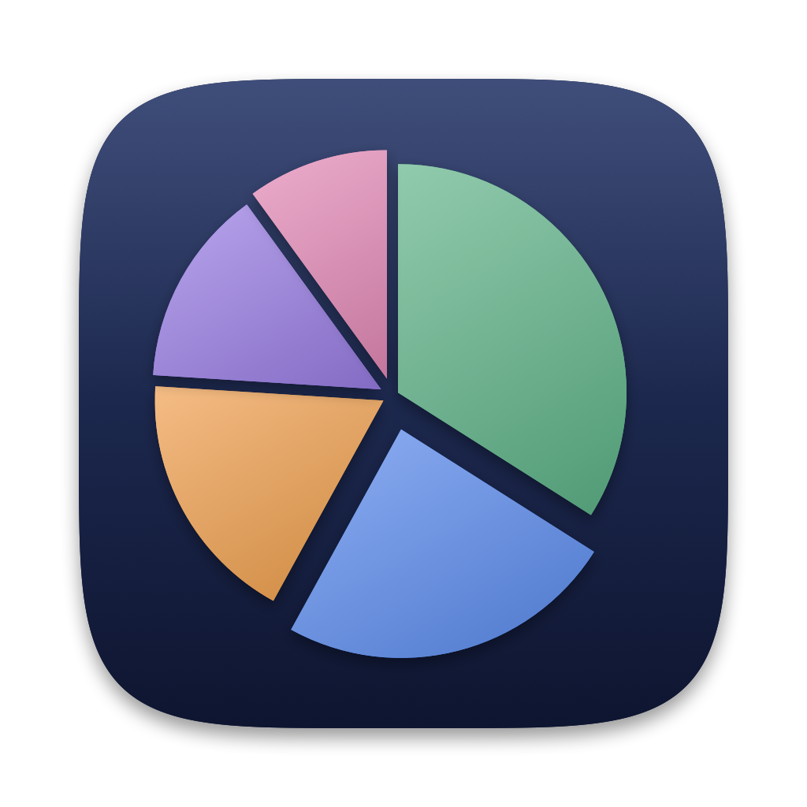

<p align="center"></p>

# Budget

Une app Mac simple pour suivre ses dépenses, ses revenus et ses comptes.

- Ajout d'une dépense en quelques secondes : ajouts rapides en un clic, ou saisie express (« essence 60 hier »)
- Catégories personnalisables, budgets mensuels par catégorie avec alertes
- Comptes courants, livrets (Livret A, LDDS…), PEA, assurance vie…, regroupés par type ou par banque, virements entre comptes
- Opérations récurrentes (loyer, salaire, abonnements) créées automatiquement
- Statistiques, prévision du solde de fin de mois
- Import de relevés bancaires (CSV, Excel, OFX), export CSV, sauvegardes automatiques
- Icône facultative dans la barre des menus (désactivée par défaut) : solde, saisie express et ajouts rapides sans ouvrir l'app
- Mode clair / sombre, deux styles visuels

> ⚠️ Version de test. Tes données de budget restent sur ton Mac et ne sont jamais envoyées. L'app se connecte seulement à GitHub pour vérifier s'il existe une nouvelle version et pour récupérer les taux des livrets réglementés. Garde l'esprit « bêta » : fais un export de temps en temps (Réglages → Données).

## Télécharger et installer

**Il faut un Mac sous macOS 14 (Sonoma) ou plus récent.** Fonctionne sur les Mac Apple Silicon (M1, M2…) et Intel.

1. Va dans la page [**Releases**](../../releases/latest) et télécharge **Budget.zip**.
2. Ouvre le fichier zip : il contient **Budget.app**.
3. Glisse **Budget.app** dans ton dossier **Applications**.
4. Ouvre l'app. La première fois, macOS va la bloquer : l'app n'est pas encore signée par Apple, c'est normal pour une version de test. Pour l'autoriser :
   - double-clique sur Budget : un message dit qu'elle ne peut pas être ouverte → clique sur **OK** ;
   - ouvre **Réglages Système → Confidentialité et sécurité** ;
   - tout en bas, à côté de « Budget a été bloquée… », clique sur **Ouvrir quand même**, puis confirme avec ton mot de passe ;
   - les fois suivantes, l'app s'ouvre normalement.

   <details>
   <summary>Alternative avec le Terminal</summary>

   ```bash
   xattr -dr com.apple.quarantine /Applications/Budget.app
   ```
   </details>

### Mises à jour

À partir de la version 0.2, l'app vérifie chaque jour s'il existe une nouvelle version et propose de l'installer en un clic (ou via **Budget ▸ Rechercher des mises à jour…**). Tes données sont conservées.
Si tu as la version 0.1, télécharge une dernière fois la nouvelle version à la main : les suivantes arriveront toutes seules.

Au premier lancement, un assistant te fait configurer ton compte principal, tes opérations récurrentes et tes ajouts rapides (tout est modifiable ensuite dans les Réglages, ⌘,).

## Raccourcis utiles

La liste complète est dans **Aide ▸ Raccourcis clavier** (⌘/) ou dans les Réglages. Les actions principales sont aussi dans le menu **Opérations**.

| Raccourci | Action |
|---|---|
| ⌘, | Réglages |
| ⌘/ | Raccourcis clavier |
| ⌘Z / ⇧⌘Z | Annuler / rétablir |
| ⌘N | Nouvelle opération |
| ⌘E | Saisie express (« café 2,5 », « courses 45 hier », « +1800 salaire ») |
| ⌘F | Rechercher |
| ⌘1 … ⌘9 | Ajouts rapides |
| ⌥⌘B | Panneau de la barre des menus (si activée dans les Réglages) |
| ⌘← / ⌘→ | Mois précédent / suivant |
| ⌘-clic, ⇧-clic | Sélection multiple / plage |
| ⌘A | Tout sélectionner |
| ⌫ | Supprimer la sélection |
| Échap | Annuler la sélection / vider la recherche |
| ↩ / ⌥↩ (saisie express) | Enregistrer / ouvrir le formulaire complet |

Dans les champs montant, tu peux taper un calcul : `12,5+8` → 20,50 €.
Pour importer un relevé, glisse le fichier (CSV, Excel ou OFX) de ta banque sur la fenêtre.

## Tes données

Tout est stocké en local dans `~/Library/Application Support/Budget/` :
- `transactions.json` (opérations), `settings.json` (catégories, comptes, réglages) ;
- `Backups/` : une sauvegarde automatique par jour (les 30 dernières sont gardées).

Pour tout remettre à zéro : quitte l'app et supprime ce dossier.

## Un bug, une idée ?

Ouvre une [issue](../../issues) en décrivant ce que tu faisais, ce qui s'est passé et ce que tu attendais (une capture d'écran aide beaucoup).

---

## Pour les développeurs

App SwiftUI (macOS 14+, prête pour iOS 17+). Seule dépendance : Sparkle (mises à jour). Il faut Xcode installé.

```bash
git clone https://github.com/Fantinl/Budget.git
cd Budget
./build-app.sh             # crée build/Budget.app (binaire universel)
./build-app.sh --install   # et la copie dans /Applications
./build-app.sh --zip       # et crée build/Budget.zip (pour une release)
```

Publier une nouvelle version pour les testeurs (compile, crée la release GitHub, signe la mise à jour et l'annonce dans `appcast.xml`) :

```bash
./release.sh 0.3.0 "Ce qui change dans cette version"
```

Les mises à jour passent par [Sparkle](https://sparkle-project.org) : la clé de signature privée est dans le trousseau du Mac qui publie (la clé publique est dans `Support/Info.plist`). L'icône se régénère avec `swift Tools/make-icon.swift`.

Le style visuel est centralisé dans `Sources/Budget/Theme.swift` : pour créer un nouveau style, copier `Theme.minimal`, changer les valeurs et l'ajouter à `Theme.all` (il apparaît dans Réglages → Apparence).
